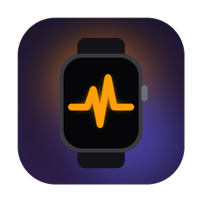
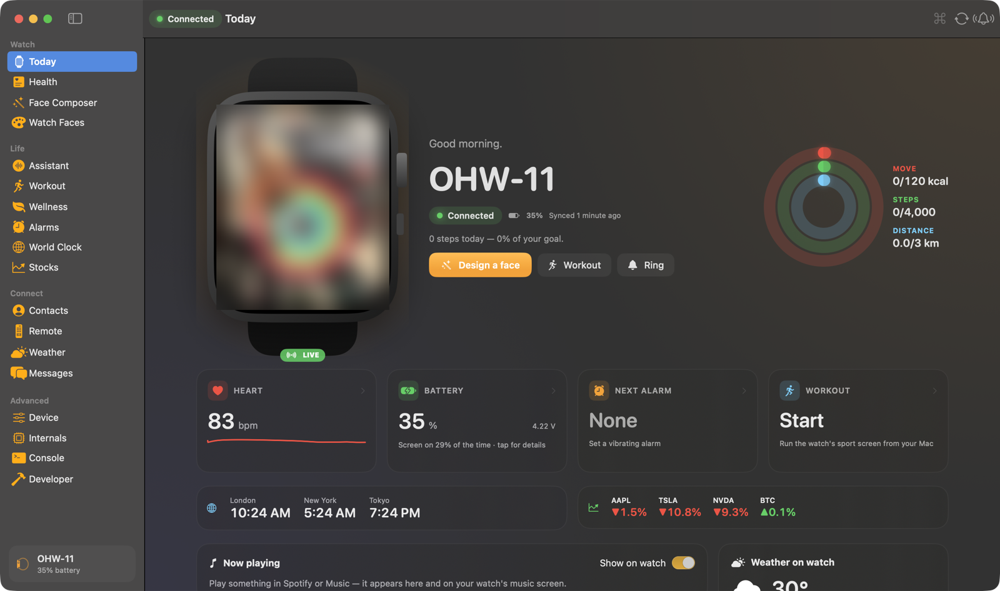
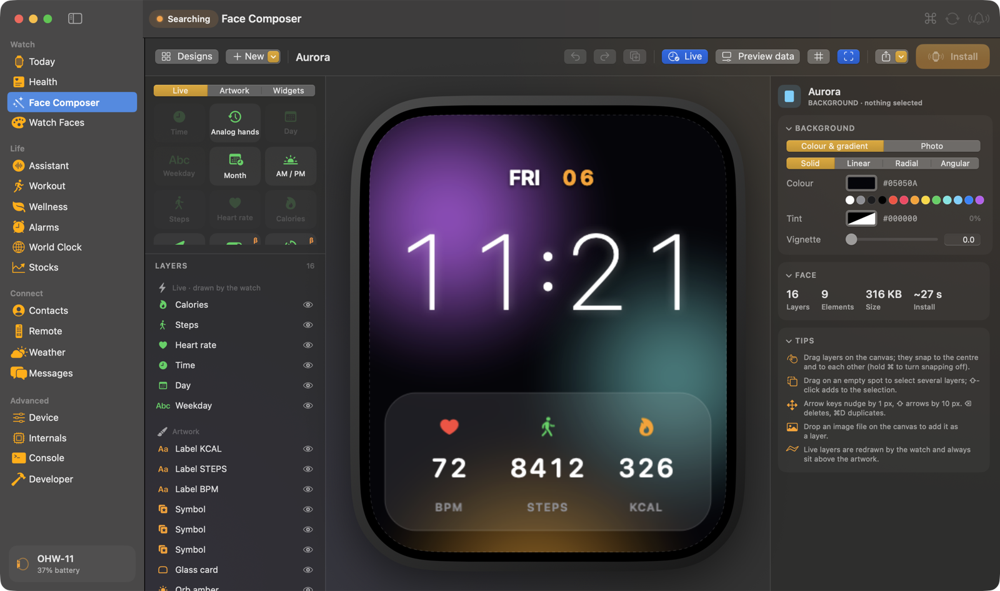
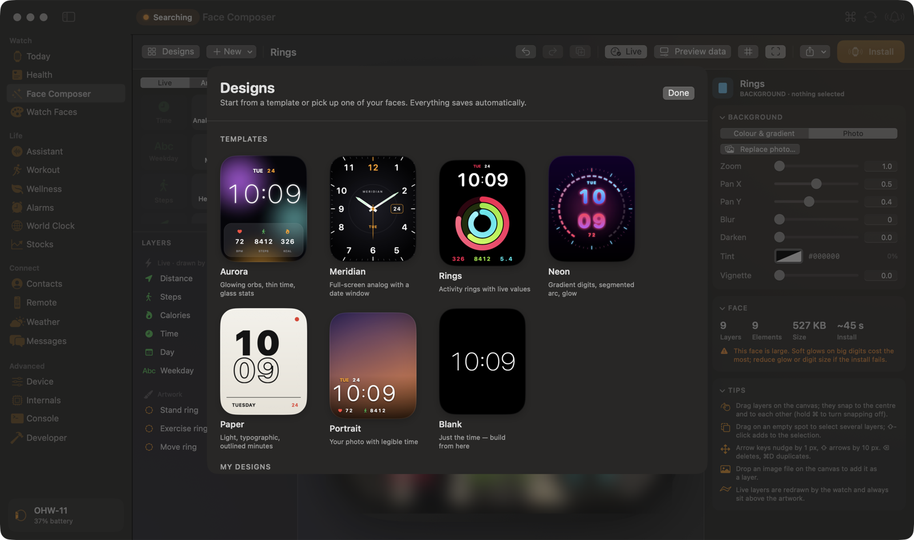
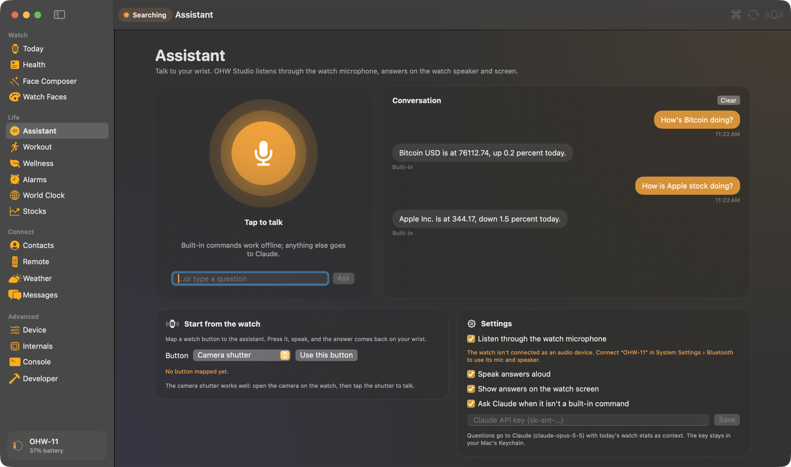
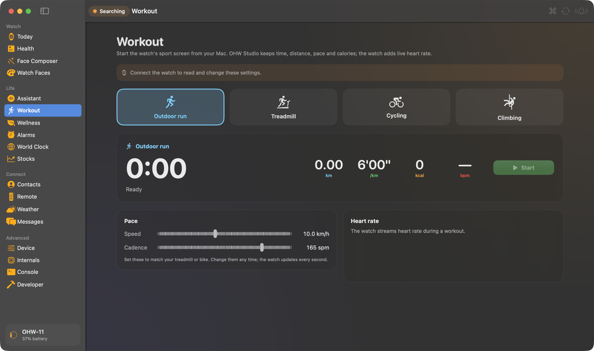
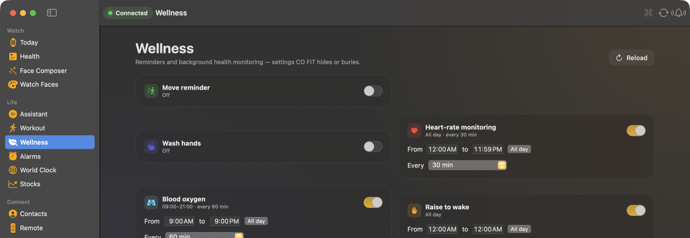
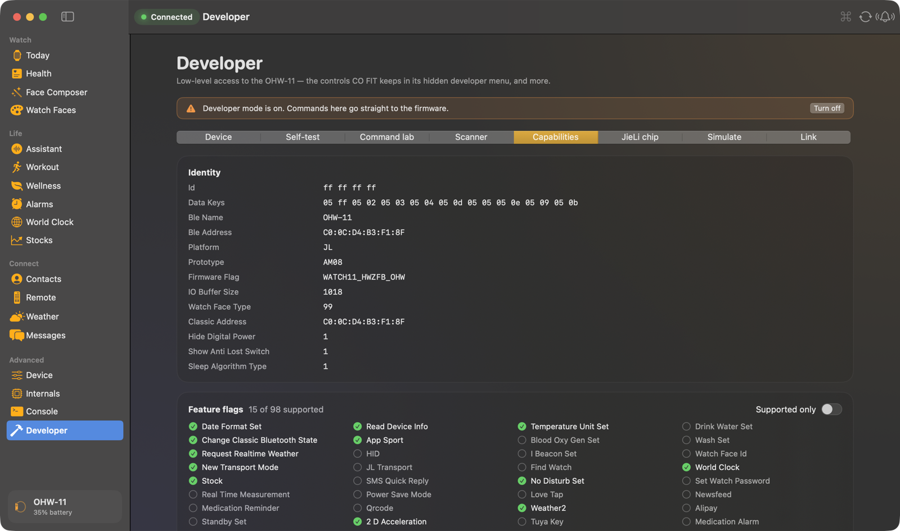
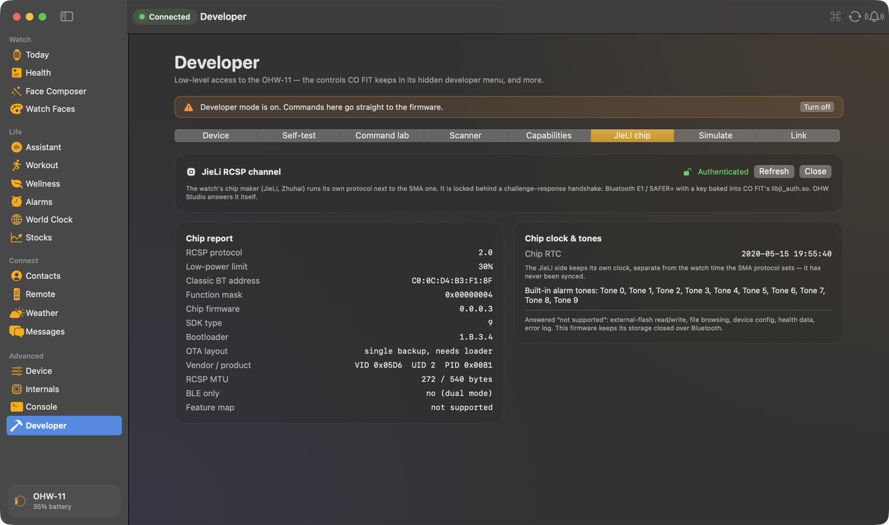
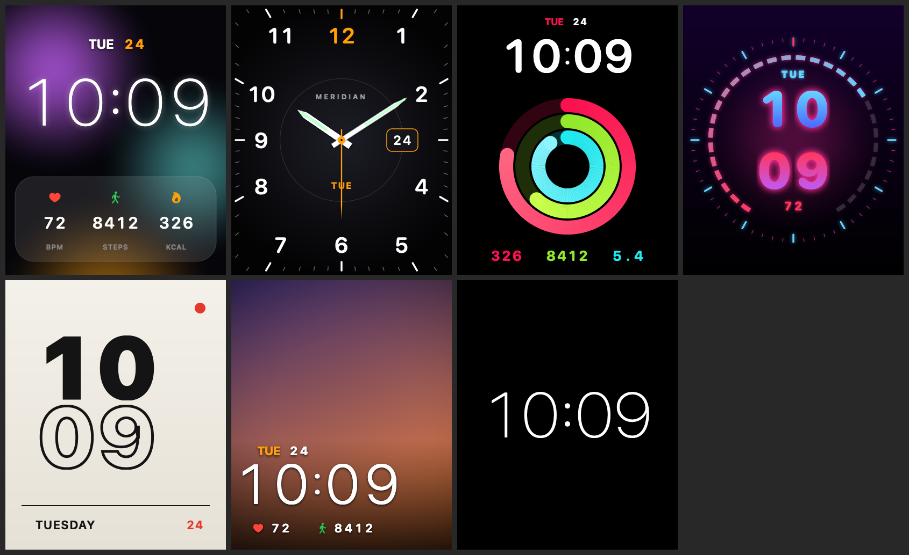

<p align="center"></p>

<h1 align="center">OHW Studio</h1>

<p align="center">
A native macOS companion app for the <b>OHW-11</b> smartwatch, built from scratch by reverse-engineering its Bluetooth protocols.<br>
Custom watch faces, a wrist voice assistant, workouts, contacts, hidden features and a full developer toolkit, with no phone and no vendor app.
</p>

<p align="center">
<a href="https://github.com/emejulucodes/ohw-studio/actions/workflows/build.yml"></a>

<a href="LICENSE"></a>


</p>

---

## What this is

The OHW-11 is an inexpensive JieLi-based smartwatch that normally only talks to the **CO FIT** phone app. This project:

1. **Cracks its protocols.** It decodes the SMA "AB" command protocol over Nordic UART and opens the chip maker's own **JieLi RCSP** channel by reimplementing its Bluetooth E1/SAFER+ handshake.
2. **Documents everything** in [`docs/FINDINGS.md`](docs/FINDINGS.md): frame formats, every working key, face file format, image encoding, upload stream, hidden features and dead ends.
3. **Ships OHW Studio**, a SwiftUI + CoreBluetooth Mac app that does what CO FIT does, plus plenty it doesn't.
4. **Includes Python research tools** ([`tools/`](tools)) used to probe, sweep and test the watch.

<p align="center"></p>

## Screenshots

| | |
|---|---|
|  **Face Composer** — layer editor with live widgets |  **Templates** — start from a design or your own faces |
|  **Assistant** — talk to your wrist |  **Workout** — start the watch's sport screen from the Mac |
|  **Wellness** — reminders and monitoring schedules |  **Developer › Capabilities** — every feature flag the watch reports |
|  **Developer › JieLi chip** — authenticated chip channel |  **Rendered faces** — what the encoder sends to the watch |

## Features

### Watch
| | |
|---|---|
| **Today** | Live mirror of the installed face, activity rings, heart / battery / alarm / workout tiles, world clock and stocks strips, now playing, weather |
| **Health** | Steps, energy, distance, live heart rate, activity, heart-rate and sleep charts, SpO₂ / stress / blood-pressure history |
| **Face Composer** | Layer-based face editor: live layers (time, date, steps, heart, kcal, distance, analog hands…) and artwork (text, SF Symbols, shapes, rings, dials, glows, photos), gradients, shadows, any font, templates and widgets, undo/redo, autosave, `.ohwface` import/export, one-click install |
| **Watch Faces** | Quick designs with accent colours and photo backgrounds |

### Life
| | |
|---|---|
| **Assistant** | Talk to your wrist. It listens through the watch mic (Bluetooth hands-free), transcribes on-device, runs built-in commands (steps, heart, battery, weather, alarms, workouts, music, stocks…) and asks Claude for everything else. Answers play on the watch speaker and show on its screen |
| **Workout** | Start an outdoor run, treadmill, cycling or climbing session on the watch from the Mac, with live pace, distance, calories and heart rate |
| **Wellness** | **Hidden cycle tracking** (period, fertile window, ovulation, watch reminders), move / water / hand-wash reminders, heart-rate and SpO₂ schedules, raise-to-wake, Do Not Disturb, body profile, SOS contact, goals |
| **Alarms · World Clock · Stocks** | Up to 10 alarms, cities for the World Clock app, live quotes pushed to the Stocks app |

### Connect
| | |
|---|---|
| **Contacts** | Up to 20 people on the watch, picked from macOS Contacts or typed in, with automatic sync of linked contacts or a Contacts group |
| **Remote** | Map watch buttons (music, camera shutter, find phone) to Mac actions: media, volume, screenshot, lock, slides, any Shortcut |
| **Weather · Messages** | Open-Meteo forecast pushed to the watch; notifications, reminders and "ring my watch" |

### Advanced
| | |
|---|---|
| **Device · Internals · Console** | Screen, brightness, step goal, clock sync, firmware log, raw settings registers, every protocol frame live |
| **Developer** *(gated)* | Rename the watch, shutdown, classic-BT toggle, time travel, time zone, language; factory self-test with live accelerometer and motor; command lab for all 318 protocol keys; key scanner; decoded capability flags; simulated buttons and calls; **JieLi chip** tab (authenticated RCSP channel, chip report, chip clock and alarm tones) |
| **⌘K / menu bar** | Command palette for every page and action; a menu-bar extra with battery, steps, heart rate and quick actions |

## Install

Download **OHW-Studio-1.0.0-macOS.zip** from the [latest release](../../releases/latest), unzip it and move **OHW Studio.app** to Applications.

The build is ad-hoc signed, not notarised, so on first launch **right-click › Open** (or run `xattr -dr com.apple.quarantine "/Applications/OHW Studio.app"`).

On first use, macOS asks for the permissions each feature needs: Bluetooth, Contacts, Microphone, Speech Recognition and Automation (Spotify/Music).

> The watch accepts **one app at a time**. Turn off the iPhone's Bluetooth, or close CO FIT, while using OHW Studio.
> For the voice assistant and the watch speaker, also connect the watch in **System Settings › Bluetooth** as an audio device.

## Build from source

Requirements: macOS 14+, Xcode 15+ (Swift 5.9), Python 3.9+ (only for the icon script and the research tools).

```bash
git clone https://github.com/emejulucodes/ohw-studio.git
cd ohw-studio
python3 -m venv .venv && .venv/bin/pip install -r tools/requirements.txt
app/scripts/build_app.sh                 # → app/build/OHW Studio.app
open "app/build/OHW Studio.app"
```

For development, `cd app && swift build && .build/debug/OHWStudio`.
Headless renders: `--render-faces <dir>` and `--render-composer <dir>` write face `.bin` files and preview PNGs.

## How it works

```
 ┌────────────── OHW-11 (JieLi AC70x, firmware 2.4.0) ──────────────┐
 │  BLE  Nordic UART 6E400001  ──  SMA "AB" protocol                 │  settings, health data, faces,
 │        AB [flags][len][crc16] [key BE16][flag][payload]           │  contacts, alarms, notifications…
 │  BLE  JieLi AE00 (AE01/AE02) ── RCSP, E1/SAFER+ handshake         │  chip info, chip RTC, tones
 │  Classic BT  HFP / A2DP / AVRCP ── audio device                   │  mic + speaker (assistant, music)
 └──────────────────────────────────────────────────────────────────┘
```

- **AB frames**: `AB 0x01 len crc16-ARC` + `key(BE16) flag payload`. Flags: 00 update, 10 read, 20 create, 30 delete, 40 reset.
- **Watch faces**: a little-endian element container with JieLi RLE images, streamed to key `0x0701` in 1018-byte chunks.
- **Contacts**: 40-byte records (name 24 B + phone 16 B) streamed to key `0x0704`.
- **JieLi RCSP**: Bluetooth E1 with a fixed key from CO FIT's `libjl_auth.so`. The watch answers target-info and system-info queries, but keeps its flash closed.

Full details, byte layouts and verification notes: **[docs/FINDINGS.md](docs/FINDINGS.md)**.

## Repository layout

```
app/                     OHW Studio (Swift package)
  Sources/OHWStudio/     ~30 Swift files (see app/README.md for a per-file map)
  scripts/build_app.sh   builds and ad-hoc signs the .app
  scripts/make_icon.py   renders the app icon
docs/
  FINDINGS.md            the reverse-engineering notebook
  images/                README artwork
tools/                   Python research tools (bleak): client, probes, sweeps, face builder, JieLi auth
research/
  captures/              raw logs from probes and sweeps (personal data redacted)
  faces/                 face test files and decoded renders
reference/sma-protocol/  MIT-licensed SMA protocol reference by Bedir Karaabalı (see its LICENSE)
```

## Research tools

All tools run from a terminal that has Bluetooth permission (Terminal.app or an IDE terminal), with OHW Studio quit:

| Tool | Purpose |
|---|---|
| `tools/ohw.py` | Main client: info, battery, read any key, set time, notify, steps, heart rate, sleep… |
| `tools/face.py` | Build and decode watch-face `.bin` files |
| `tools/remote.py` | Watch buttons → Mac actions (the original remote) |
| `tools/probe_keys.py`, `tools/sweep_keys.py` | READ every known key, then every possible key |
| `tools/jl_auth.py`, `tools/jl_rcsp.py` | JieLi E1 handshake and RCSP explorer |
| `tools/hidden_test.py` | Tests for hidden features (cycle tracking, live measurement) |
| `tools/contacts_test.py`, `workout_test.py`, `factory_test.py`, `gsensor_test.py`, … | Single-feature experiments |

## Status

| Works | Doesn't work on this firmware |
|---|---|
| Faces, alarms, world clock, stocks, reminders, workouts, contacts, cycle tracking, assistant via HFP, rename, factory test, JieLi auth | Schedules, G-sensor and game-control streams, BLE AI voice / AUDIO_TEXT, boot logo, NFC (on-device only), "measure now", JieLi flash/file access |

## Disclaimer

Independent interoperability research on hardware I own. Not affiliated with CO FIT, SMA, Shenzhen Coding IOT or JieLi.
No vendor code or binaries are included: the decompiled app and its native libraries stay out of the repository.
Developer features can rename, power off or factory-test the watch, so use them at your own risk.

## License

[MIT](LICENSE) © 2026 Emmanuel Emejulu. The bundled protocol reference in `reference/sma-protocol/` keeps its own MIT license.

## Author

**Emmanuel Emejulu** · [@emejulucodes](https://github.com/emejulucodes)
